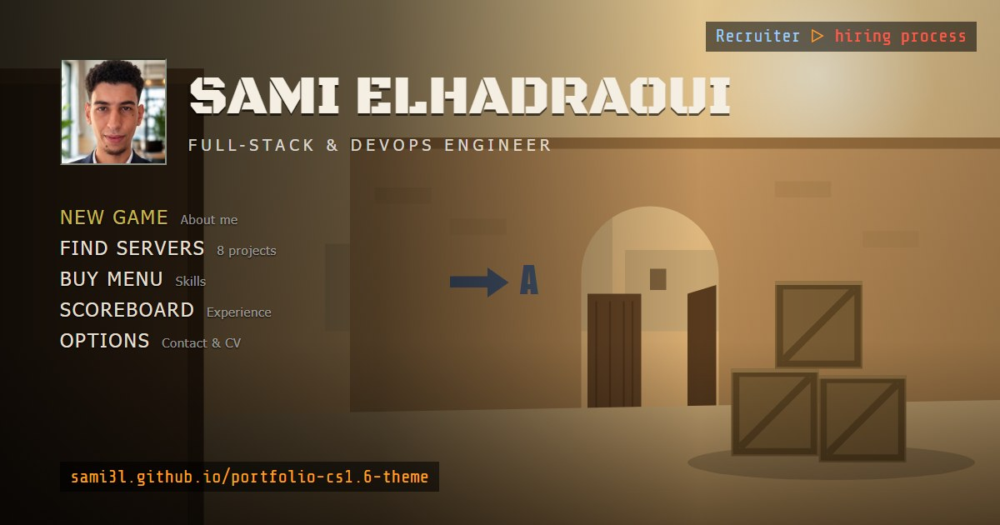

# de_career: a Counter-Strike 1.6 portfolio

The personal portfolio of **Sami Elhadraoui**, Full-Stack & DevOps Engineer, built as a tribute to the Counter-Strike 1.6 main menu.

**▶ Live: [sami3l.github.io/portfolio-cs1.6-theme](https://sami3l.github.io/portfolio-cs1.6-theme/)**

[](https://sami3l.github.io/portfolio-cs1.6-theme/)

## What's inside

Every part of the classic menu is a section of the portfolio:

| In the game | In the portfolio |
| --- | --- |
| **New Game** (message of the day) | About me, languages, interests and the "choose a team" shortcuts |
| **Find Servers** | Projects: filter by tab or text, then connect to open a project's details, links and screenshots |
| **Buy Menu** | Skills by category, with the projects and jobs where each one was used |
| **Scoreboard** | Work experience (Counter-Terrorists), education (Terrorists) and certifications |
| **Options** | Contact details, CV downloads, player name, sound and theme |
| **Console** | Commands like `help`, `connect <project>`, `cv en`, `status`, plus a few easter eggs |
| **Quit** | Exactly what you'd expect |

It also has a loading screen on the first visit, a "connecting to server" screen when opening a project, a kill feed for notifications, UI sounds, and a plain [résumé view](https://sami3l.github.io/portfolio-cs1.6-theme/#resume) for anyone who'd rather skip the game. The English and French CVs can be downloaded from the About window, the Options window, the résumé view, or with `cv en` / `cv fr` in the console.

### Controls

| Key | Action |
| --- | --- |
| `~` | Toggle the console |
| `B` | Buy menu (skills) |
| Hold `TAB` | Scoreboard (experience) |
| `1`–`9`, `0` | Pick items in the buy menu and team select; `0` goes back |
| `Esc` | Close the top window, or cancel a connection |

Every window has its own URL (`#projects/stratospend`, `#skills`…), so sections can be linked to directly, and the browser's back button closes windows. On phones, windows open full-screen and everything works by touch.

## Tech

- **React 19 + TypeScript + Vite**, with no UI library. The VGUI windows, tabs, tables and buttons are small hand-written components.
- State lives in a single React context and reducer, and the URL hash mirrors the top window.
- The artwork is original: the desert-town background is inline SVG and the weapon icons are simple SVG paths. **No Valve assets are used**, and the sounds are synthesized with the Web Audio API.
- [GoatCounter](https://www.goatcounter.com/) visit stats: cookie-free, no consent banner needed.
- Deployed to GitHub Pages by GitHub Actions on every push to `main`.

## Editing the content

All the text lives in one typed file: **[`src/data/portfolio.ts`](src/data/portfolio.ts)**. That covers the profile, projects, skills, experience and contact details. Edit it, push, and the site redeploys.

| To change… | Do this |
| --- | --- |
| Profile, projects, skills, experience | Edit `src/data/portfolio.ts` |
| Project screenshots | Drop images into `src/assets/projects/<project-id>/`. They appear automatically, sorted by file name ([details](src/assets/projects/README.md)) |
| CVs | Replace `public/resume/english_version.pdf` / `french_version.pdf`, keeping the same names |
| Profile photo | Replace `public/avatar.jpg` (square, about 320 px) |
| Link-preview image | Replace `public/og-image.jpg` (1200×630) |
| Colours | The tokens in `src/styles/tokens.css` |

## Run locally

Requires Node.js 20 or newer.

```bash
npm install
npm run dev       # http://localhost:5173
npm run build     # production build in dist/
npm run preview   # serve the production build
npm run lint
```

## Project structure

```
src/
  data/          portfolio.ts (all content) and its types
  components/    VGUI primitives (Window, Button, Tabs), menu, background, icons
  windows/       one component per window: MOTD, server browser, buy menu…
  hud/           console and kill feed
  console/       console command registry
  views/         loading screens, résumé view, goodbye screen
  state/         store (context + reducer) and URL-hash routing
  hooks/         hotkeys, dragging, per-window keys
  styles/        design tokens, VGUI styles, per-window styles
  analytics.ts   GoatCounter page views and events
.github/workflows/deploy.yml   build and deploy to GitHub Pages
```

## Contact

- E-mail: [elhadraoui.sami.iir@gmail.com](mailto:elhadraoui.sami.iir@gmail.com)
- LinkedIn: [linkedin.com/in/elhadraoui-sami](https://www.linkedin.com/in/elhadraoui-sami)
- GitHub: [github.com/sami3l](https://github.com/sami3l)

---

<sub>Fan-made tribute. Counter-Strike is a trademark of Valve Corporation; this project is not affiliated with or endorsed by Valve and uses no game assets.</sub>
